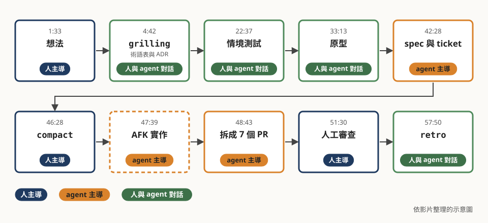
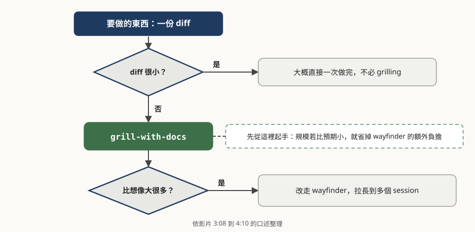
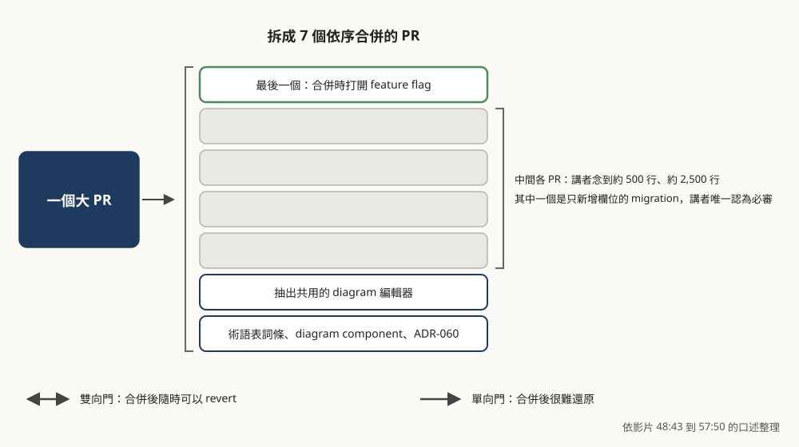
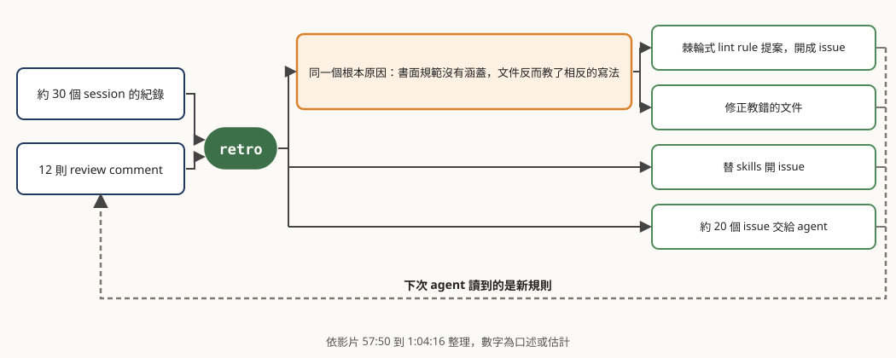
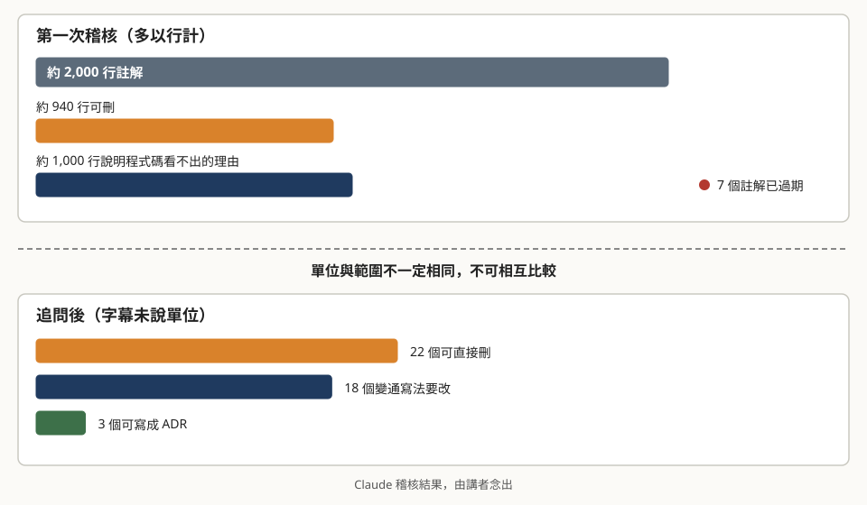

# Matt Pocock 做完一個兩萬一千行的功能：他在哪裡出手，在哪裡放手

> 本導讀的分析與撰稿由 AI 模型完成，不是人類分析，也沒有經過人工逐句校稿，見〈製作說明〉。

*圖說：AI 生成的示意插畫，象徵一個從便利貼上的名詞開始長出來的功能；圖內沒有文字，也不是影片畫面。*

Matt Pocock 開場就說：「你們一次又一次地要我展示我的開發流程究竟是什麼樣子」（[00:00](https://www.youtube.com/watch?v=jVBlkOF8sHk&t=0s)）。這次他把一個真正要用的功能從頭做到尾：改造自己影片製作工具裡的縮圖編輯器，讓 diagram 可以直接畫在縮圖裡他的臉旁邊（[00:54](https://www.youtube.com/watch?v=jVBlkOF8sHk&t=54s)）。他預告會特別著重兩個 skill（[00:26](https://www.youtube.com/watch?v=jVBlkOF8sHk&t=26s)）：開工前把想法問清楚的 grill-with-docs，和做完後回頭檢討整批 session 的 retro。grilling 是他對「讓 agent 逐題追問、把想法問清楚」的叫法。

## 三十秒版

- 他要讓 diagram 直接畫在縮圖裡自己的臉旁邊，開工時卻說完全不知道怎麼做。
- 動手前，他用 grill-with-docs 讓 agent 逐題追問，先把名稱與資料模型問清楚。
- 外觀交給原型：agent 做了三個版本，他只留一個，再寫成 spec 與 ticket。
- 他把對話 compact（壓縮成摘要），讓 implement-spec AFK（人不在電腦前）實作，回來得到一個大 PR，再請 agent 拆成 7 個堆疊的小 PR。
- 他審程式碼，除了確認能動，也在意產出程式碼的系統；12 則 review comment 交給 retro，變成一批 issue 與 lint rule 提案。
- 他說自己在前段對齊時最有價值；grilling 和 retro 是他和系統互動的兩個主要時間點。

## 這篇怎麼讀

全片是 Matt Pocock 一個人的螢幕錄影加口述，環境是 Claude Code、Opus 5.5 搭配 medium effort（[04:25](https://www.youtube.com/watch?v=jVBlkOF8sHk&t=265s)）。片中數字與評價多是講者自述；他常念出畫面上 Claude 的提問與回覆，本文寫成「Claude 回覆說」，不算成他的話。利益關係：他是 [mattpocock/skills](https://github.com/mattpocock/skills) 的作者，示範的就是自己的 skills，開場也推了自己的課程（[01:23](https://www.youtube.com/watch?v=jVBlkOF8sHk&t=83s)）。內容依影片機器字幕整理，時間戳可以直接跳到影片對應位置。

*圖說：本文依影片整理的流程示意圖；時間是各段在影片中開始的位置，各站標的人主導或 agent 主導是本文依字幕的歸納，不是講者自己的分類。compact 指把對話壓縮成摘要，AFK 指人離開電腦、讓 agent 自己跑。*

## 他想做的東西，和他不知道怎麼做的部分

他的課程與影片都在自己寫的工具 Course Video Manager（CVM）裡製作（[01:33](https://www.youtube.com/watch?v=jVBlkOF8sHk&t=93s)）。現行的縮圖做法要繞一大圈：切到 diagram 產生器截一塊視窗，再貼回縮圖（[02:08](https://www.youtube.com/watch?v=jVBlkOF8sHk&t=128s)）。他想直接在縮圖上畫，卻坦白：「我真的完全不知道該怎麼打造這個功能。」（[02:57](https://www.youtube.com/watch?v=jVBlkOF8sHk&t=177s)）

開始新工作時，他先走一棵決策樹選 skill，把要做的東西看成**新舊程式碼庫之間的 diff**（[03:25](https://www.youtube.com/watch?v=jVBlkOF8sHk&t=205s)）。diff 很小，大概直接一次做完就好；這次他知道東西不小，所以選 grill-with-docs（[03:42](https://www.youtube.com/watch?v=jVBlkOF8sHk&t=222s)）。做到一半如果發現比想像大很多，再改走 wayfinder，把 grilling 拉長到好幾個 session（[03:45](https://www.youtube.com/watch?v=jVBlkOF8sHk&t=225s)）。

*圖說：本文依影片 3:08 到 4:10 的口述整理的示意圖；先 grill-with-docs、太大再轉 wayfinder 的順序是講者的偏好。*

## grilling：先把名稱與資料模型問清楚

這次 grilling 的重點放在領域建模，也就是經典的 DDD（領域驅動設計）技巧（[00:38](https://www.youtube.com/watch?v=jVBlkOF8sHk&t=38s)）。

### 講為什麼，由人決定何時停

他的第一段提示是口述的（[04:53](https://www.youtube.com/watch?v=jVBlkOF8sHk&t=293s)）：他喜歡縮圖產生器逼自己把臉放上畫面，不喜歡附 diagram 的繁瑣流程，UI 會長什麼樣子也不知道（[05:27](https://www.youtube.com/watch?v=jVBlkOF8sHk&t=327s)）。說完他提醒觀眾，這段提示**只講要解決的問題**，沒說確切該做什麼：「如果我給它原因，agent 就會更放得開手，自己去產出解決方案，或者也許就解決方案跟我討論一下。」（[05:53](https://www.youtube.com/watch?v=jVBlkOF8sHk&t=353s)）

他設想觀眾可能會想：這和 plan mode 之類的做法比起來好在哪（[09:41](https://www.youtube.com/watch?v=jVBlkOF8sHk&t=581s)）。他的回答是，這個 skill 讓人和 agent 在動手前先對要做的東西取得共識，產出會更可預測（[09:56](https://www.youtube.com/watch?v=jVBlkOF8sHk&t=596s)）。對話也要由人主導：「不是 agent 在 grilling 你。」（[14:29](https://www.youtube.com/watch?v=jVBlkOF8sHk&t=869s)）隨時可以說談得夠多了，該去寫程式了。

### 術語表、ADR 與柴斯特頓的籬笆

他的術語表大約 560 行，定義了這個 repo 的主要概念（[10:46](https://www.youtube.com/watch?v=jVBlkOF8sHk&t=646s)）。照它的定義，diagram 其實是一組 diagram snapshot，也就是拍 clip 當下那張 diagram 的複本（[11:07](https://www.youtube.com/watch?v=jVBlkOF8sHk&t=667s)）。他擔心要放進縮圖的東西「只是一個單一 snapshot」（[12:12](https://www.youtube.com/watch?v=jVBlkOF8sHk&t=732s)）。外行人聽來像行話，他說模型聽得懂，因為術語檔就在它的 context 裡（[12:29](https://www.youtube.com/watch?v=jVBlkOF8sHk&t=749s)）。術語表也在 grilling 中更新：Claude 提議新增 thumbnail 與 cutout 兩個詞條（[13:43](https://www.youtube.com/watch?v=jVBlkOF8sHk&t=823s)），之後又提出 thumbnail drawing（[15:06](https://www.youtube.com/watch?v=jVBlkOF8sHk&t=906s)），並建議避開 thumbnail diagram（[15:16](https://www.youtube.com/watch?v=jVBlkOF8sHk&t=916s)）。

agent 也讀了一份過去的 ADR（架構決策紀錄）（[16:15](https://www.youtube.com/watch?v=jVBlkOF8sHk&t=975s)）。他的分工是：術語表某種程度上描述了應用程式目前的樣貌（[16:35](https://www.youtube.com/watch?v=jVBlkOF8sHk&t=995s)），ADR 負責解釋當初為什麼這樣決定（[16:40](https://www.youtube.com/watch?v=jVBlkOF8sHk&t=1000s)）。他把這稱為典型的「柴斯特頓的籬笆」問題，念了 G. K. Chesterton 在《The Thing》裡的段落（[archive.org 全文](https://archive.org/download/thingwhyiamcatho0000ches/thingwhyiamcatho0000ches_djvu.txt)）：路上橫著一道籬笆，看不出它有什麼用就不准拆，先去想清楚（[16:54](https://www.youtube.com/watch?v=jVBlkOF8sHk&t=1014s)）。

> 重點：在他的用法裡，ADR 就是幫人追蹤每道籬笆為什麼立起來的紀錄（[17:25](https://www.youtube.com/watch?v=jVBlkOF8sHk&t=1045s)）。

*圖說：AI 生成的比喻插畫：籬笆是程式裡看似多餘的設計，旁邊的路牌象徵記錄理由的 ADR；圖內沒有文字。*

### 他答不出來的題目，和 agent 越線的時候

接下來的題目他自己也卡住：要接軌到既有的 diagram 與 snapshot，還是換個資料模型和名稱，「本質上是在決定要不要把兩條線混在一起」（[18:34](https://www.youtube.com/watch?v=jVBlkOF8sHk&t=1114s)）。他比較傾向不混，但擔心日後會後悔，只是又說不出非得綁在一起的具體情境（[18:41](https://www.youtube.com/watch?v=jVBlkOF8sHk&t=1121s)）。Claude 回覆說會順著他的直覺分開，複製時記一個可為空值的 started from snapshot 參照就夠了（[19:14](https://www.youtube.com/watch?v=jVBlkOF8sHk&t=1154s)）。他對用詞這麼執著，是因為語言將會構成往後所有東西依附的資料模型（[19:41](https://www.youtube.com/watch?v=jVBlkOF8sHk&t=1181s)）。

agent 也會越線。它自作主張替 thumbnail drawing 寫了詞條（[20:58](https://www.youtube.com/watch?v=jVBlkOF8sHk&t=1258s)），又未經詢問建了一份新的 ADR（[21:19](https://www.youtube.com/watch?v=jVBlkOF8sHk&t=1279s)）。他說：「我希望這個決策是在 grilling session 期間由我來做出的決定。」（[21:24](https://www.youtube.com/watch?v=jVBlkOF8sHk&t=1284s)）聽完 Claude 列的建 ADR 理由，他說確實同意（[22:09](https://www.youtube.com/watch?v=jVBlkOF8sHk&t=1329s)）；他願意在這裡花時間，因為少了這一步，下一次執行時效果會差很多（[22:23](https://www.youtube.com/watch?v=jVBlkOF8sHk&t=1343s)）。

### 情境測試：三個候選名

他同意 thumbnail diagram 有點彆扭，請 agent 給幾個選項做情境測試（[22:31](https://www.youtube.com/watch?v=jVBlkOF8sHk&t=1351s)）：**列出描述系統的句子**，看換成不同詞彙時好不好說（[22:57](https://www.youtube.com/watch?v=jVBlkOF8sHk&t=1377s)）。Claude 的表格比較三個候選（[23:09](https://www.youtube.com/watch?v=jVBlkOF8sHk&t=1389s)），他邊念邊評，下表把他的評語和 Claude 表格的判斷分開列：

| 候選名 | Matt 的評語 | Claude 表格的判斷 |
|---|---|---|
| thumbnail diagram snapshot | 有點太長、太囉唆（[24:14](https://www.youtube.com/watch?v=jVBlkOF8sHk&t=1454s)）；snapshot 不能變動，在 snapshot 裡拖曳箭頭的說法不通（[23:47](https://www.youtube.com/watch?v=jVBlkOF8sHk&t=1427s)；這句是他的評語還是 Claude 表格的判斷，字幕分不出來） | 字幕未念出 |
| thumbnail diagram | 這是他自然會說出口的詞（[24:18](https://www.youtube.com/watch?v=jVBlkOF8sHk&t=1458s)） | 唯一的缺點是讀起來像某種 diagram（[25:02](https://www.youtube.com/watch?v=jVBlkOF8sHk&t=1502s)） |
| thumbnail scene | 不是他會用的字，比較像寫程式的詞彙（[24:22](https://www.youtube.com/watch?v=jVBlkOF8sHk&t=1462s)）；術語表別處已經有 scene（[24:39](https://www.youtube.com/watch?v=jVBlkOF8sHk&t=1479s)） | 各情境基本上都沒問題，只有「Matt 工作時會大聲說出來」那一列例外（[24:08](https://www.youtube.com/watch?v=jVBlkOF8sHk&t=1448s)）；技術上最清楚，但不是他說話的方式（[24:57](https://www.youtube.com/watch?v=jVBlkOF8sHk&t=1497s)） |
| thumbnail drawing（Claude 先前提議） | 不喜歡這個詞，念起來不順口（[25:17](https://www.youtube.com/watch?v=jVBlkOF8sHk&t=1517s)） | 先前曾建議用它（見上文） |

結論是 thumbnail diagram：只要有一份 ADR 說明它是 diagram 又不完全是 diagram，這個名稱就說得通（[25:06](https://www.youtube.com/watch?v=jVBlkOF8sHk&t=1506s)）。

### 其餘問題

核心想通後，他請 agent 一次問多題（[25:37](https://www.youtube.com/watch?v=jVBlkOF8sHk&t=1537s)）。其中幾題：component 會和 React 的 component 撞名，改成 diagram component（[28:05](https://www.youtube.com/watch?v=jVBlkOF8sHk&t=1685s)）；他不要兩個有微小差異的 diagram 編輯器（[28:56](https://www.youtube.com/watch?v=jVBlkOF8sHk&t=1736s)），後來 Claude 問要不要把 playground 的編輯器抽成共用元件，他立刻答應（[30:57](https://www.youtube.com/watch?v=jVBlkOF8sHk&t=1857s)）；Claude 指出刪影片會連帶硬刪除縮圖（[29:56](https://www.youtube.com/watch?v=jVBlkOF8sHk&t=1796s)），他說這些資料很寶貴，所以「幾乎總是選擇軟刪除」（[30:39](https://www.youtube.com/watch?v=jVBlkOF8sHk&t=1839s)）。

agent 也會漏看。畫面上的第 26 題說搜尋 diagram 的步驟目前還不存在，他認為不是真的：「它實際上沒有注意到程式碼中的某些東西，這讓人有點惱火。」（[31:14](https://www.youtube.com/watch?v=jVBlkOF8sHk&t=1874s)）在他看來，grilling 也是和程式碼保持接觸的方式（[32:02](https://www.youtube.com/watch?v=jVBlkOF8sHk&t=1922s)）。

## 原型：看了才知道自己討厭什麼

grilling 中途，agent 就問要不要先做幾種編輯介面的原型（[12:54](https://www.youtube.com/watch?v=jVBlkOF8sHk&t=774s)）。他的看法是：「如果它做出你不喜歡的東西，那往往比你從喜歡的東西中能學到的還要多」（[13:23](https://www.youtube.com/watch?v=jVBlkOF8sHk&t=803s)）。三個版本裡，B 版把臉放進畫布，第三版是分割檢視，他都不滿意，直說分割檢視根本是垃圾（[34:08](https://www.youtube.com/watch?v=jVBlkOF8sHk&t=2048s)）。A 版跟他想像的蠻接近（[33:27](https://www.youtube.com/watch?v=jVBlkOF8sHk&t=2007s)），他選了 A，放棄另外兩版，只繼續迭代它（[35:37](https://www.youtube.com/watch?v=jVBlkOF8sHk&t=2137s)）。

*圖說：AI 生成的示意插畫：三個原型只留一個；圖內沒有文字，不代表影片中原型的實際樣子。*

這段人在迴圈裡的時間，是用來大幅**縮小 agent 的決策空間**：外觀和資料模型都定了（[36:41](https://www.youtube.com/watch?v=jVBlkOF8sHk&t=2201s)），之後 AFK 時，agent 只要把這兩樣東西接起來（[36:53](https://www.youtube.com/watch?v=jVBlkOF8sHk&t=2213s)）。第二版原型放進真正的縮圖頁面後，他發現自己開始一路回「對、對、對」，代表雙方已經一致，grilling 快收尾了（[38:49](https://www.youtube.com/watch?v=jVBlkOF8sHk&t=2329s)）。

這一版匯出圖右邊還有一條小白條。agent 打算先在自己的瀏覽器重現，再讀像素顏色找出白色從哪裡來（[39:15](https://www.youtube.com/watch?v=jVBlkOF8sHk&t=2355s)），他說「這一代的 agent 似乎非常、非常擅長這件事」（[39:33](https://www.youtube.com/watch?v=jVBlkOF8sHk&t=2373s)）。他有一點不滿：agent 沿用了已用到 260k token 的子 agent，已經相當深入 dumb zone（[39:54](https://www.youtube.com/watch?v=jVBlkOF8sHk&t=2394s)）。結果 Claude 回覆說白條不算問題，只是 Windows 125% 縮放下預覽圖最後一欄像素只畫了一部分（[42:30](https://www.youtube.com/watch?v=jVBlkOF8sHk&t=2550s)）。

## smart zone 與 dumb zone

等原型的空檔，他回答了 smart zone 與 dumb zone 的問題。他說這個說法不是他原創，是 Dex Horthy 提出的：agent 到了大約 150k token，會開始變得稍微笨一點（[40:27](https://www.youtube.com/watch?v=jVBlkOF8sHk&t=2427s)）。他的解釋是，模型要追蹤所有 token 之間的關係，關係數以平方速度成長，最後要龐大的記憶體和工作量才能在雜訊中聽出訊號（[41:01](https://www.youtube.com/watch?v=jVBlkOF8sHk&t=2461s)）。

*圖說：本文依講者的口頭解釋繪製的示意圖，只表達「關係數隨 token 數平方增加」這個說法，不代表任何模型的實際門檻。*

至於什麼時候該清 context，以前幾代模型大概 120k 就得清（[41:32](https://www.youtube.com/watch?v=jVBlkOF8sHk&t=2492s)），現在「它真的更像是一種成本與最佳化的問題」（[41:50](https://www.youtube.com/watch?v=jVBlkOF8sHk&t=2510s)）。agent 在 dumb zone 未必會產生幻覺，比較像是成果變差（[42:00](https://www.youtube.com/watch?v=jVBlkOF8sHk&t=2520s)）；context 到了約 750k token 時運作非常昂貴，快取一失效，先前所有 token 都要再算一次、再計一次費（[42:17](https://www.youtube.com/watch?v=jVBlkOF8sHk&t=2537s)）。

## spec、ticket 與 compact：把決策空間縮到最小

原型確定後，他叫用 to-spec 與 to-tickets（[43:52](https://www.youtube.com/watch?v=jVBlkOF8sHk&t=2632s)）。「spec 就像是一份目的地文件」（[44:07](https://www.youtube.com/watch?v=jVBlkOF8sHk&t=2647s)），說明最後要抵達哪裡；ticket 界定每個 session 的範圍，每個子 agent 拿一張。到了這一步，他要儘量**不給 agent 決策空間**，理由是「你給 agent 越多的模糊彈性，它的表現就會越差」（[45:41](https://www.youtube.com/watch?v=jVBlkOF8sHk&t=2741s)）。spec 建成一個 GitHub issue，裡面大約 47 個 user story（[46:08](https://www.youtube.com/watch?v=jVBlkOF8sHk&t=2768s)）。

接著他 compact 目前的對話，再對 spec 下 implement-spec（[46:29](https://www.youtube.com/watch?v=jVBlkOF8sHk&t=2789s)）。他說最近更常用 compact，它變得可靠得多（[46:44](https://www.youtube.com/watch?v=jVBlkOF8sHk&t=2804s)），但 auto-compact 仍有點不可靠（[46:53](https://www.youtube.com/watch?v=jVBlkOF8sHk&t=2813s)）。他預估大約要一小時或 45 分鐘，做完會得到一個可以合併的 PR（[47:28](https://www.youtube.com/watch?v=jVBlkOF8sHk&t=2848s)）；這種時候，他會離開電腦，信任它 AFK 自己跑（[47:39](https://www.youtube.com/watch?v=jVBlkOF8sHk&t=2859s)）。

## 21,000 行，他怎麼審

回來時 PR 已經在那裡，畫面上的數字是新增 21,000 行（[48:21](https://www.youtube.com/watch?v=jVBlkOF8sHk&t=2901s)）；開場他說的是「我想大概有 25,000 行」（[01:11](https://www.youtube.com/watch?v=jVBlkOF8sHk&t=71s)）。接下來他做了平常不做的事：在觀眾面前審這個 PR（[48:44](https://www.youtube.com/watch?v=jVBlkOF8sHk&t=2924s)）。他想試另一種把大 PR 拆小的方法，「我目前還沒有專門處理這個的 skill」（[48:58](https://www.youtube.com/watch?v=jVBlkOF8sHk&t=2938s)）。

他請 agent 用堆疊式 diff 拆成較小的區塊，每塊理想上能獨立審查，希望是一連串雙向門，最後以一道單向門作結；定義在 [pr skill](https://github.com/mattpocock/skills/blob/main/skills/engineering/pr/SKILL.md) 裡（[49:05](https://www.youtube.com/watch?v=jVBlkOF8sHk&t=2945s)）。雙向門的 PR **合併後隨時可以 revert**，單向門則是合併後就非常難以還原的 PR（[49:30](https://www.youtube.com/watch?v=jVBlkOF8sHk&t=2970s)）。他說 agent 相當擅長把大 PR 拆成小 PR（[49:53](https://www.youtube.com/watch?v=jVBlkOF8sHk&t=2993s)）。最後一塊特別大，他就問能不能用 feature flag 讓 thumbnail diagram 先上線、必要時再收回，並坦白自己有點像是在角色扮演，平常這個 repo 只是個人軟體（[50:17](https://www.youtube.com/watch?v=jVBlkOF8sHk&t=3017s)）。agent 把它再拆成四個，合併最後一個 PR 時才把 flag 打開（[51:03](https://www.youtube.com/watch?v=jVBlkOF8sHk&t=3063s)），總共 7 個 PR（[51:31](https://www.youtube.com/watch?v=jVBlkOF8sHk&t=3091s)）。第一個是術語表詞條、diagram component 和 ADR-060（[51:47](https://www.youtube.com/watch?v=jVBlkOF8sHk&t=3107s)），第二個是抽出共用的 diagram 編輯器（[51:56](https://www.youtube.com/watch?v=jVBlkOF8sHk&t=3116s)）。

*圖說：本文依影片 48:43 到 57:50 的口述整理的示意圖；行數是講者看畫面時念出的數字，影片沒有逐一說明每個 PR 的大小，中間各 PR 只標出他提到的內容。*

### 他也審產出程式碼的系統

這次逐行看，是因為知道觀眾想看他怎麼審（[52:04](https://www.youtube.com/watch?v=jVBlkOF8sHk&t=3124s)），他不認為每個人都需要這樣做。審查當然要確認東西能動（[52:27](https://www.youtube.com/watch?v=jVBlkOF8sHk&t=3147s)）；這次他是唯一的使用者，所以全部合併、最後再來檢查（[52:39](https://www.youtube.com/watch?v=jVBlkOF8sHk&t=3159s)）。看程式碼的另一個用意是，他也關心產出這段程式碼的系統（[52:51](https://www.youtube.com/watch?v=jVBlkOF8sHk&t=3171s)）。

> 重點：看到出錯的地方或不喜歡的 pattern，他想做的是建一條 lint rule 之類的東西，讓它不再發生（[52:55](https://www.youtube.com/watch?v=jVBlkOF8sHk&t=3175s)）。

所謂不喜歡，是他對那件事有個假說，「認為它正以負面的方式影響我 agent 運作的環境」（[53:09](https://www.youtube.com/watch?v=jVBlkOF8sHk&t=3189s)）。他的 review comment 大致三類：

- 註解太多，會讓 agent 要更新的面積變大（[53:24](https://www.youtube.com/watch?v=jVBlkOF8sHk&t=3204s)）。
- 用 `as` 欺騙 TypeScript，他要禁止 shared utilities 以外的 `as`（[54:07](https://www.youtube.com/watch?v=jVBlkOF8sHk&t=3247s)）；`Pick` 加交集型別也改用 `interface extends`。
- `useSearchParams` 用魔術字串抓參數，改名時不會有型別錯誤，他要更型別安全的設計（[55:40](https://www.youtube.com/watch?v=jVBlkOF8sHk&t=3340s)）。

方向很明白：「我試圖逼它設計出能消除所有細微模糊處、替 agent 省去所有決策的 API。」（[55:33](https://www.youtube.com/watch?v=jVBlkOF8sHk&t=3333s)）規則不必第一天就強制，可以**棘輪式逐步收緊**（[55:06](https://www.youtube.com/watch?v=jVBlkOF8sHk&t=3306s)）。

接下來的 PR，他念到 500 行（[56:21](https://www.youtube.com/watch?v=jVBlkOF8sHk&t=3381s)）與大約 2,500 行，字幕沒說是那個 PR 的大小還是累計（[56:39](https://www.youtube.com/watch?v=jVBlkOF8sHk&t=3399s)）。這些意見他都不當成 blocking；整串 PR 裡他唯一認為必須審的，是替 thumbnail diagram 只新增欄位的那個 migration（[57:06](https://www.youtube.com/watch?v=jVBlkOF8sHk&t=3426s)）。最後他請 agent 依序合併所有 PR，合併放到背景子 agent 去跑（[57:54](https://www.youtube.com/watch?v=jVBlkOF8sHk&t=3474s)）。

## retro：把審查意見變成系統

合併在背景跑的時候，他用同一個 session 叫用 retro，請它看這次執行的所有 agent session，也把他的 review comment 抓進來（[58:35](https://www.youtube.com/watch?v=jVBlkOF8sHk&t=3515s)）。對話雖然 compact 過，之前的 session 都存在本機硬碟，仍然讀得到（[58:47](https://www.youtube.com/watch?v=jVBlkOF8sHk&t=3527s)）。Claude 回覆說，它正派 agent 梳理 30 幾個 session 的逐字紀錄和他的 12 則 review comment（[59:19](https://www.youtube.com/watch?v=jVBlkOF8sHk&t=3559s)）。

*圖說：本文依影片 57:50 到 1:04:16 整理的示意圖；session 數、review comment 數與 issue 數都是影片中念出或估計的數字；回饋箭頭是本文歸納，影片沒有示範下一輪。*

Claude 的結論是，12 則 review comment 有同一個根本原因：CVM 的**書面規範沒有涵蓋**這些點（[59:53](https://www.youtube.com/watch?v=jVBlkOF8sHk&t=3593s)），coding standards 與前端 state 的文件寫的反而是他否決的 pattern，main 上已經有數千個實例（[59:59](https://www.youtube.com/watch?v=jVBlkOF8sHk&t=3599s)）。他的反應是：「看來我顯然是在試圖讓一艘巨大油輪掉頭。」（[1:00:09](https://www.youtube.com/watch?v=jVBlkOF8sHk&t=3609s)）

Claude 排序清單的前三項：

- 第 1 項，把 review comment 轉成棘輪式收緊的檢查；Claude 說光是 shared utilities 以外的 `as` 就會抓到 2,000 個實例（[1:00:19](https://www.youtube.com/watch?v=jVBlkOF8sHk&t=3619s)），他說這些都該在 repo 開成 issue（[1:01:35](https://www.youtube.com/watch?v=jVBlkOF8sHk&t=3695s)）。
- 第 2 項，修正那些在教被否決 pattern 的文件，他說顯然要做（[1:01:57](https://www.youtube.com/watch?v=jVBlkOF8sHk&t=3717s)）。
- 第 3 項，原型程式碼被直接複製、沒有重新實作，Claude 建議修改 prototype 與 implement-spec 等 skill；他請 agent 到 mattpocock/skills 開 issue，說他的 skill 常常就是這樣改進的（[1:02:17](https://www.youtube.com/watch?v=jVBlkOF8sHk&t=3737s)）。

他對這次 retro 的評價是「非常非常棒」（[1:03:54](https://www.youtube.com/watch?v=jVBlkOF8sHk&t=3834s)），估計可能整理出大約 20 個 issue，大概不需要 grilling，可以直接交給 agent、拿回 PR（[1:04:01](https://www.youtube.com/watch?v=jVBlkOF8sHk&t=3841s)）。

## 註解稽核：他要 agent 更激進

註解是清單裡的例外，Claude 說沒有合適的 lint rule。他也說：「是啊，我不知道該拿註解怎麼辦。」（[1:01:06](https://www.youtube.com/watch?v=jVBlkOF8sHk&t=3666s)）他提到 Lauren Tan（poteto）直接禁止註解，自己有點想往那個方向走，但考慮分階段（[1:01:08](https://www.youtube.com/watch?v=jVBlkOF8sHk&t=3668s)）。Claude 的統計是，新功能 features/diagrams 有 18% 的行數是註解，整個 repo 平均 12%（[1:01:21](https://www.youtube.com/watch?v=jVBlkOF8sHk&t=3681s)）。

稽核回來，Claude 回覆說大約 2,000 行註解裡，大約 940 行現在就可以刪，大約 1,000 行解釋了程式碼裡看不到的原因，另有 7 個註解已經過期（[1:04:23](https://www.youtube.com/watch?v=jVBlkOF8sHk&t=3863s)）。他說「這些註解有點像是 agent 放在那裡的遮羞布」（[1:04:49](https://www.youtube.com/watch?v=jVBlkOF8sHk&t=3889s)），要它更激進一點，分出三類：可以移進 ADR、可以改成不需要變通的寫法、可以直接刪掉（[1:05:18](https://www.youtube.com/watch?v=jVBlkOF8sHk&t=3918s)）。Claude 同意，**變通寫法旁的註解**通常標記著那裡的程式碼本該換個方式設計（[1:05:42](https://www.youtube.com/watch?v=jVBlkOF8sHk&t=3942s)）。追問的結果，Claude 說 22 個可以直接刪除、18 個變通寫法需要修改（[1:07:09](https://www.youtube.com/watch?v=jVBlkOF8sHk&t=4029s)），3 個可以寫成 ADR，這 3 個他都同意適合寫成 ADR（[1:07:37](https://www.youtube.com/watch?v=jVBlkOF8sHk&t=4057s)）。

*圖說：Claude 的稽核結果，由講者念出；第一次多以行計，第二次字幕沒說單位，兩次範圍也都沒說明，分格呈現，不可相互比較。*

## 試用成品與他認為自己的價值在哪

整串 PR 合併到正式環境後，他打開新的縮圖編輯器，擷取臉部、加上文字、畫框（[1:06:07](https://www.youtube.com/watch?v=jVBlkOF8sHk&t=3967s)），評語是「還挺不錯的」（[1:06:30](https://www.youtube.com/watch?v=jVBlkOF8sHk&t=3990s)）。接下來他會進去做 QA，把可以改進的地方開成 issue，交給 agent 一口氣做完，大概連 grilling 都不用（[1:08:03](https://www.youtube.com/watch?v=jVBlkOF8sHk&t=4083s)）。

片尾他說：「我在一開始的對齊階段最有價值」（[1:08:41](https://www.youtube.com/watch?v=jVBlkOF8sHk&t=4121s)），把一切討論清楚、理解要做什麼、做出原型；最後他也很有用，技術專業派得上用場，能貫徹自己的程式碼標準（[1:08:50](https://www.youtube.com/watch?v=jVBlkOF8sHk&t=4130s)）。grilling 和 retro 是他與系統互動的**兩個主要時間點**（[1:08:59](https://www.youtube.com/watch?v=jVBlkOF8sHk&t=4139s)）。

*圖說：本文依影片 1:08:35 起講者的總結繪製的示意圖。*

## 講者說的與官方不太一樣的地方

以下各項只列有實質差異者，官方資料讀取日為 2026-11-20。

- implement-spec 的終點：他說做完會得到一個可以合併的 PR（[47:33](https://www.youtube.com/watch?v=jVBlkOF8sHk&t=2853s)），官方 [implement-spec SKILL.md](https://github.com/mattpocock/skills/blob/main/skills/engineering/implement-spec/SKILL.md) 寫的目標則是單一 integration branch，PR 是條件式的產物，只有 issue tracker 以 PR 結案或使用者要求時才開 draft PR。他在片中用的是 GitHub issue，所以看到 PR 並不矛盾，差別在官方語意不把 PR 當作預設終點。
- ADR 何時建立：agent 自己說這個決策並不難逆轉（[21:58](https://www.youtube.com/watch?v=jVBlkOF8sHk&t=1318s)），仍未先詢問就建了 ADR（[21:19](https://www.youtube.com/watch?v=jVBlkOF8sHk&t=1279s)），官方 [domain-modeling SKILL.md](https://github.com/mattpocock/skills/blob/main/skills/engineering/domain-modeling/SKILL.md) 則要難以逆轉、沒有 context 會意外、有真正取捨三者同時成立，才提議建立。
- smart zone 的 150k：他把約 150k 歸給 Dex Horthy（[40:27](https://www.youtube.com/watch?v=jVBlkOF8sHk&t=2427s)），但 Horthy 在 [AI Engineer 講座](https://www.youtube.com/watch?v=rmvDxxNubIg)講的是約 40% 的 context 利用率開始邊際遞減、視任務而定，約 150k 這個數字則見於 Matt 自己 skills repo 的 [CHANGELOG](https://github.com/mattpocock/skills/blob/main/CHANGELOG.md)，記錄由約 120k 改成約 150k。
- Lauren Tan 與註解：他說 Lauren Tan「直接禁止寫註解」（[1:01:08](https://www.youtube.com/watch?v=jVBlkOF8sHk&t=3668s)），她在[〈All Code Is Slop (Except Mine)〉演講](https://www.youtube.com/watch?v=O_zcc6Xl12g)說的是在 Grabot 禁掉 99% 的註解，用的詞是 escape hatch。
- retro 讀 review comment：他說 retro 會用 GitHub CLI 抓他的 review comment（[58:54](https://www.youtube.com/watch?v=jVBlkOF8sHk&t=3534s)），官方 [retro SKILL.md](https://github.com/mattpocock/skills/blob/main/skills/engineering/retro/SKILL.md) 沒有這一步，這次是他在提示裡要求一併讀取（[58:40](https://www.youtube.com/watch?v=jVBlkOF8sHk&t=3520s)）。

## 讀這支影片要記得的限制

- 個人軟體，單人使用。他是唯一的使用者（見上文），拆 PR、feature flag 那段是他「假裝這是一個正式環境的系統」（[50:17](https://www.youtube.com/watch?v=jVBlkOF8sHk&t=3017s)）。
- 不是平常的做法。鏡頭前審 PR、用堆疊式 diff 拆 PR、逐行審，都是他說平常不這樣做、或因為有觀眾才做的（見上文）；這套取捨放到多人協作、對外服務的系統，影片沒有示範。
- 工具仍有毛病。他說 auto-compact 仍有點不可靠（[46:53](https://www.youtube.com/watch?v=jVBlkOF8sHk&t=2813s)）；agent 會擅自寫詞條、建 ADR（[20:52](https://www.youtube.com/watch?v=jVBlkOF8sHk&t=1252s)），也會漏看既有程式碼（[31:14](https://www.youtube.com/watch?v=jVBlkOF8sHk&t=1874s)）。
- 成本與耗時沒有揭露。實作時間只有他事前「大約一小時或 45 分鐘」的預估（[47:28](https://www.youtube.com/watch?v=jVBlkOF8sHk&t=2848s)），影片剪過，總 token 用量與實際花費都沒有交代。
- 數字是自述。行數有開場約 25,000 與畫面上 21,000 兩個說法（[01:11](https://www.youtube.com/watch?v=jVBlkOF8sHk&t=71s)），session 數開場他說「我想我們在這支影片裡大概進行了 30 個 session」（[01:07](https://www.youtube.com/watch?v=jVBlkOF8sHk&t=67s)），user story 數、註解比例與稽核數字也都是他口述或念出 Claude 的回覆，本文沒有逐一核實。
- 經驗談沒有數據。講為什麼 agent 會更有創意、產出更可預測、agent 擅長拆 PR、決策空間越少表現越好、這一代 agent 似乎很擅長驗證自己的成果，這些是他的經驗談，影片沒有附數據。
- 沒有對照組。他說這套做法比 plan mode 之類的方式更能事先對齊（[09:41](https://www.youtube.com/watch?v=jVBlkOF8sHk&t=581s)），影片沒有用同一個功能比較兩種做法的結果。

## 重點結論與實際啟示

下面三件是他實際做的，各自附上適用條件：

1. 他的做法：**對 agent 講為什麼**，不急著講做什麼。需求還模糊、自己都說不清 UI 長什麼樣子時，先描述問題與在意的地方，讓 agent 用追問把選項攤開；這是他的經驗，片中沒有對照。條件（本文推論）：要有時間陪它一題一題回答，並且由人決定何時停。
2. 他的做法：**先定名稱與術語表**，再談實作。把領域詞彙寫成一份放在 repo 裡、agent 每次都讀得到的檔案，用詞拿不定時，用情境測試把候選名放進實際句子裡比；決策理由寫成 ADR，他希望由他在 grilling 中決定，不讓 agent 自己建。條件（本文推論）：適合會長期維護的 repo。diff 很小的改動，他自己也是直接做。
3. 他的做法：把 review 意見**交給 retro**，讓它變成 lint rule 提案、文件修正或 issue。每則意見背後先有一個假說：這個 pattern 會讓 agent 的工作環境變差；規則可以先不強制、再逐步收緊。條件（本文推論）：session 紀錄要保存下來讓 retro 讀得到，也要有 issue tracker 承接後續。他用的是 GitHub。

三件都出自一個人的個人專案與一次剪輯過的錄影，適用範圍見上一節〈讀這支影片要記得的限制〉。

## 製作說明：這篇導讀由 AI 模型完成

本導讀的分析與撰稿由 AI 模型完成，不是人類分析，也沒有經過人工逐句校稿。影片內容依 YouTube 機器字幕（en-orig），未對照原音逐句校對，少數語意不明的句子沒有引用。主控為 Claude Sonnet 5.5；逐句繁中翻譯由 agy（gemini-3.8-flash-medium）完成，再由 Sonnet 逐章修詞、Opus 統一審查用詞與程度詞；撰稿由 Opus 負責；查證由 Sonnet subagent 進行，並經主控核對一手來源，重要說法須有一手來源，只有單方者降級標示；查證只用 Claude 系 subagent 與 gh 等工具，沒有另請其他模型交叉查證。圖片中，資訊型的示意圖由 Sonnet subagent 依文中資料以程式繪成 SVG，並經檢查；封面與比喻插畫由 Codex 的圖像生成工具（imagegen）製作。初稿之後，審稿 A（事實）與審稿 B（編輯）由兩位獨立的 Opus subagent 平行進行、互不參照，兩份意見由 Opus 合併修稿，再由一位 Opus subagent 做終審，再由一位 Opus 依總編輯準則潤稿並標示重點；因初版篇幅過長，最後另由一位 Opus 精簡正文。獨立評分後，又由一位 Opus 依評分意見再精簡一次。引文的中文是翻譯而非講者原話，字幕可能有誤。完整譯文見[全文譯本](translation-zh.html)，雙語同步播放器見[字幕同步播放器](player.html)。

## 來源清單

- Watch me ship a 21,000-line feature with mattpocock/skills，Matt Pocock，YouTube，2026-11-18 上傳，[https://www.youtube.com/watch?v=jVBlkOF8sHk](https://www.youtube.com/watch?v=jVBlkOF8sHk)
- mattpocock/skills，官方 GitHub repo，2026-11-20 讀取（最新 release v1.3.2，2026-10-29），[https://github.com/mattpocock/skills](https://github.com/mattpocock/skills)
  - implement-spec SKILL.md：[https://github.com/mattpocock/skills/blob/main/skills/engineering/implement-spec/SKILL.md](https://github.com/mattpocock/skills/blob/main/skills/engineering/implement-spec/SKILL.md)
  - domain-modeling SKILL.md：[https://github.com/mattpocock/skills/blob/main/skills/engineering/domain-modeling/SKILL.md](https://github.com/mattpocock/skills/blob/main/skills/engineering/domain-modeling/SKILL.md)
  - retro SKILL.md：[https://github.com/mattpocock/skills/blob/main/skills/engineering/retro/SKILL.md](https://github.com/mattpocock/skills/blob/main/skills/engineering/retro/SKILL.md)
  - pr SKILL.md：[https://github.com/mattpocock/skills/blob/main/skills/engineering/pr/SKILL.md](https://github.com/mattpocock/skills/blob/main/skills/engineering/pr/SKILL.md)
  - CHANGELOG.md：[https://github.com/mattpocock/skills/blob/main/CHANGELOG.md](https://github.com/mattpocock/skills/blob/main/CHANGELOG.md)
- No Vibes Allowed: Solving Hard Problems in Complex Codebases，Dex Horthy（HumanLayer），AI Engineer，2025-12-02，[https://www.youtube.com/watch?v=rmvDxxNubIg](https://www.youtube.com/watch?v=rmvDxxNubIg)
- All Code Is Slop (Except Mine)，Lauren Tan，AI Engineer，2026-11-14，[https://www.youtube.com/watch?v=O_zcc6Xl12g](https://www.youtube.com/watch?v=O_zcc6Xl12g)
- The Thing: Why I Am a Catholic，G. K. Chesterton，1930 年版（第 IV 章〈The Drift from Domesticity〉開頭），Internet Archive 掃描全文，[https://archive.org/download/thingwhyiamcatho0000ches/thingwhyiamcatho0000ches_djvu.txt](https://archive.org/download/thingwhyiamcatho0000ches/thingwhyiamcatho0000ches_djvu.txt)
